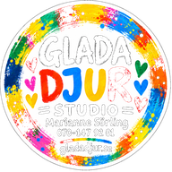

<div align="center">



# Glada djur

**Barnkläder, presentartiklar, konst och lek – fyra varumärken under samma tak.**

[**gladadjur.se**](https://gladadjur.se/) · [Hitta hit](https://www.google.com/maps/search/?api=1&query=Storgatan+15+523+30+Ulricehamn)

</div>

---

## Om butiken

Glada djur är en butik på Storgatan 15 i Ulricehamn, driven av Marianne Sörling.

| Varumärke | Kategori | Beskrivning |
| --- | --- | --- |
| **Lekloop** | Barnkläder | Färgglada, justerbara plagg i storlek 50–116 |
| **Cirka** | Presentartiklar | Handgjorda produkter av återbrukade textilier |
| **Glada djur Studio** | Konst | Personliga, handmålade tavlor |
| **Blåbert** | Lek | Handsydda dinosaurier med eget födelsebevis |

## Öppettider

| Dag | Tid |
| --- | --- |
| Tisdag–fredag | 10.00–18.00 |
| Lördag | 10.00–14.00 |
| Söndag–måndag | Stängt |

**Öppet hus:** måndag 2 november 2026, kl. 16.00–20.00.

## Kontakt

- Adress: Storgatan 15, 523 30 Ulricehamn
- Telefon/sms: [070 147 92 01](tel:+46701479201)
- E-post: [marianne@sorling.nu](mailto:marianne@sorling.nu)

## Webbplatsen

Statisk webbplats (HTML och CSS) som publiceras på [gladadjur.se](https://gladadjur.se/).

```text
index.html     Startsida med JSON-LD (Store, Event, öppettider)
styles.css     Formgivning
img/           Optimerade bilder (webp/png) och logotyper
img-org/       Originalbilder
site.xml       Sitemap
robots.txt     Sökmotorinställningar
CNAME          Domän för GitHub Pages
```

<div align="center">

© 2026 Glada djur – Ulricehamn

</div>
